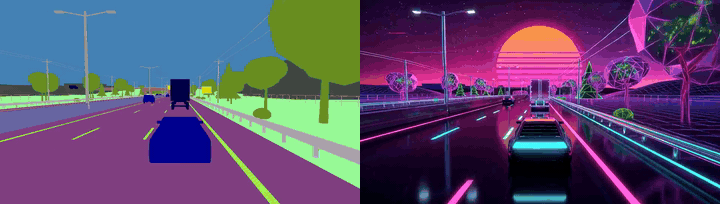

# Example: a synthwave highway run

A retro synthwave highway run: a neon-trimmed coupe overtakes a glowing semi-truck, flies under a neon gantry and
overpass at dusk, and slides back into its lane.

| File | What it is |
|---|---|
| `structure.mp4` | semantic segmentation, 1344×768, 24 fps, 158 frames |
| `first.png` | the first frame, in the synthwave look |
| `prompt.txt` | the six-part prompt |

```bash
python scripts/render.py --h3 ./MiniMax-H3 \
    --control weights/solarrenderer_control_lora.safetensors \
    --fewstep weights/solarrenderer_4step_lora.safetensors \
    --structure examples/sem-highway_synthwave/structure.mp4 \
    --first examples/sem-highway_synthwave/first.png \
    --prompt examples/sem-highway_synthwave/prompt.txt \
    --out render.mp4 --seed 0
```

<p align="center"></p>

Structure (left) and the four-step render (right).
